# Database ER Diagram — NeuroPlant AI

PostgreSQL, SQLAlchemy 2.0 (async), Alembic-managed. Native dev falls back to
SQLite (portable types: String, JSON, Integer). All tables use a
`bigint`/`uuid` PK, `created_at`/`updated_at` timestamps, and FK indexes.

## Mermaid ER diagram

```mermaid
erDiagram
    users ||--o| farmer_profiles : has
    users ||--o| expert_profiles : has
    users ||--o| seller_profiles : has
    users ||--o| refresh_tokens : owns
    users ||--o{ devices : registers
    users ||--o{ login_events : produces
    users ||--o| mfa : enables
    users ||--o{ notifications : receives
    users ||--o{ audit_logs : acts

    crops ||--o{ diseases : host
    crops ||--o{ crop_plans : planned
    crops ||--o{ marketplace_listings : sold
    crops ||--o{ crop_prices : priced
    diseases ||--o{ treatments : treated_by
    diseases ||--o{ scans : predicted
    diseases ||--o{ outbreak_reports : reported
    diseases ||--o{ unknown_disease_samples : labeled_as
    fertilizers ||--o{ soil_deficiency_predictions : recommended
    pesticides ||--o{ store_products : sold_as

    farmer_profiles ||--o{ soil_records : records
    soil_records ||--o{ soil_deficiency_predictions : predicts
    farmer_profiles ||--o{ crop_plans : runs
    crop_plans ||--o{ calendar_events : schedules
    crop_plans ||--o{ yield_predictions : forecasts
    crop_plans ||--o{ crop_health_series : monitors

    users ||--o{ scans : makes
    scans ||--o{ crop_health_entries : feeds
    crop_health_series ||--o{ crop_health_entries : groups
    crop_health_series ||--o{ health_reports : generates

    users ||--o{ chat_sessions : chats
    chat_sessions ||--o{ chat_messages : contains
    users ||--o{ conversations : joins
    conversations ||--o{ messages : contains

    users ||--o{ community_posts : authors
    community_posts ||--o{ comments : has
    community_posts ||--o{ likes : gets
    community_posts ||--o{ shares : gets
    users ||--o{ appointments : books
    users ||--o{ appointments : hosts_as_expert

    users ||--o{ marketplace_listings : sells
    users ||--o{ offers : makes
    marketplace_listings ||--o{ offers : negotiates
    marketplace_listings ||--o{ order_items : contains
    orders ||--o{ order_items : comprises
    orders ||--o{ order_tracking_events : tracked_by
    orders ||--o{ order_deliveries : shipped_by
    delivery_partners ||--o{ order_deliveries : provides
    users ||--o{ orders : places_as_buyer
    users ||--o{ orders : receives_as_seller

    users ||--o{ store_products : sells
    store_products ||--o{ product_reviews : rated_by
    users ||--o{ transactions : records
    orders ||--o{ transactions : logs
    store_products ||--o{ transactions : logs

    users ||--o{ outbreak_reports : submits
    outbreak_reports ||--o{ outbreak_verifications : verified_by
    markets ||--o{ crop_prices : quotes
    markets ||--o{ price_predictions : predicted_for

    datasets ||--o{ model_versions : trains
    unknown_disease_samples }o--|| datasets : ingested_into
    model_versions ||--o{ scans : used_by
    model_versions ||--o{ yield_predictions : used_by
    telemetry }o--|| users : streamed_from

    users {
        bigint id PK
        enum role "farmer|customer|expert|seller|admin"
        text phone "unique"
        citext email
        text password_hash
        text name
        text avatar_url
        text lang "default+detected"
        float lat
        float lng
        text address
        boolean verified
        text status "active|suspended"
    }
    scans {
        bigint id PK
        bigint user_id FK
        uuid client_scan_id UK "idempotency"
        jsonb media_items "source_type,url,lat,lng"
        text part_type "leaf|fruit|stem|plant"
        bigint predicted_disease_id FK
        float confidence
        text severity
        text stage
        jsonb symptoms
        text model_version
        text dataset_version
        text ai_provider "local|cloud"
        text heatmap_url
        text explanation
        text status "queued|processing|done|failed"
    }
    crop_health_entries {
        bigint id PK
        bigint series_id FK
        bigint scan_id FK
        int health_score "0-100"
        text trend "improving|worsening|stable"
        text treatment_status "continue|change|stop"
    }
    crop_health_series {
        bigint id PK
        bigint user_id FK
        bigint crop_id FK
        bigint crop_plan_id FK
        text plant_name
        boolean active
    }
    soil_records {
        bigint id PK
        bigint user_id FK
        float ph
        float n
        float p
        float k
        float moisture
        float organic_carbon
        date test_date
        text method
    }
    calendar_events {
        bigint id PK
        bigint plan_id FK
        text type "sowing|watering|fertilizer|pesticide|harvest"
        date schedule_date
        text recurrence
        boolean done
        boolean reminder_sent
    }
    crop_prices {
        bigint id PK
        bigint crop_id FK
        bigint market_id FK
        numeric price
        date date
    }
    orders {
        bigint id PK
        bigint buyer_id FK
        bigint seller_id FK
        text status "pending|paid|accepted|shipped|delivered|cancelled"
        numeric total
        text payment_id
        text razorpay_order_id
    }
    offers {
        bigint id PK
        bigint listing_id FK
        bigint from_user_id FK
        bigint counter_to_id FK
        numeric price
        text status "pending|accepted|declined|countered"
    }
    transactions {
        bigint id PK
        bigint user_id FK
        text type "income|expense"
        text category
        numeric amount
        bigint related_id
        text related_type "order|store|scan|manual"
        date tx_date
        text source "manual|order|store"
    }
    outbreak_reports {
        bigint id PK
        text anon_ref
        float lat
        float lng
        text district
        text state
        bigint crop_id FK
        bigint disease_id FK
        jsonb symptoms
        jsonb image_urls
        text status "pending|verified|rejected"
        bigint verified_by FK
    }
    unknown_disease_samples {
        bigint id PK
        jsonb image_urls
        bigint crop_id FK
        text reported_symptoms
        bigint submitted_by FK
        text status "pending|reviewing|labeled|approved|rejected"
        bigint labeled_disease_id FK
        bigint reviewed_by FK
        text dataset_version
    }
    model_versions {
        bigint id PK
        text name "disease|yield|soil"
        text version
        text artifact_url
        bigint dataset_version FK
        jsonb metrics
        text status "training|staging|production|retired"
    }
```

## Table inventory

| Group | Tables |
|---|---|
| Identity & auth | `users`, `refresh_tokens`, `devices`, `login_events`, `mfa`, `farmer_profiles`, `expert_profiles`, `seller_profiles` |
| Knowledge catalog | `crops`, `diseases`, `treatments`, `fertilizers`, `pesticides` |
| Detection & crop doctor | `scans`, `crop_health_series`, `crop_health_entries`, `health_reports` |
| Soil / calendar / yield | `soil_records`, `soil_deficiency_predictions`, `crop_plans`, `calendar_events`, `yield_predictions` |
| Intelligence | `weather_records`, `disease_risk_predictions`, `markets`, `crop_prices`, `price_predictions`, `govt_schemes`, `outbreak_reports`, `outbreak_verifications` |
| Dataset platform | `unknown_disease_samples`, `datasets`, `model_versions` |
| Marketplace / store / finance | `marketplace_listings`, `offers`, `orders`, `order_items`, `order_tracking_events`, `order_deliveries`, `delivery_partners`, `store_products`, `product_reviews`, `marketplace_reviews`, `transactions`, `financial_records` |
| Community / experts | `community_posts`, `post_images`, `comments`, `likes`, `shares`, `appointments`, `conversations`, `messages` |
| Cross-cutting | `notifications`, `audit_logs`, `outbox_events`, `telemetry` |

## Indexing strategy

- All `*_id` FKs (b-tree).
- `users(phone)` unique; `scans(client_scan_id)` unique; `scans(user_id, created_at desc)`.
- `crop_prices(crop_id, market_id, date)`; `notifications(user_id, read_at)`.
- `outbreak_reports(district, status)`; lat/lng bounding-box columns on
  `markets`, `outbreak_reports`, `users` (PostGIS deferred to roadmap).
- JSON columns (`media_items`, `symptoms`, `treatments`) kept as `jsonb` in
  Postgres; heavy-query paths materialize projection columns.
