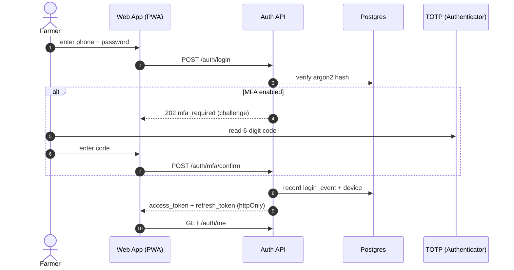
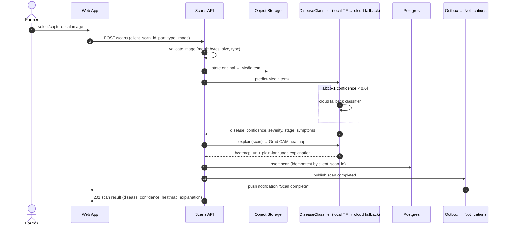
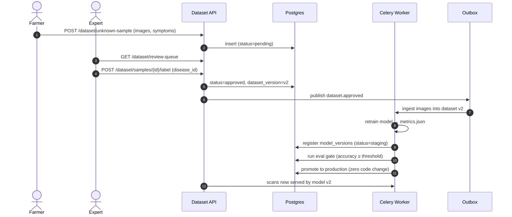
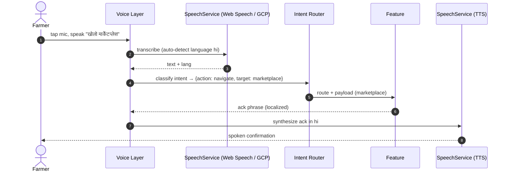
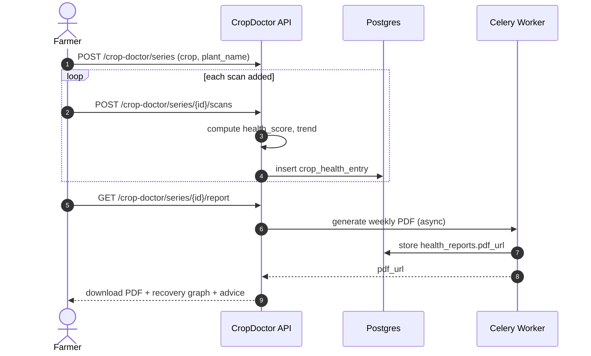

# Sequence Diagrams — NeuroPlant AI

Key flows rendered as Mermaid sequence diagrams. Rendered on GitHub, GitLab, or
[mermaid.live](https://mermaid.live).

## 1. Authentication (password + MFA)



## 2. Disease scan (upload → AI → explain → persist)



## 3. Offline scan → auto-sync

```mermaid
sequenceDiagram
    autonumber
    actor F as Farmer
    participant W as Web App
    participant IDB as IndexedDB
    participant TFJS as TF.js (on-device)
    participant Sync as Sync Engine
    participant API as Scans API

    Note over F,W: offline
    F->>W: capture leaf image
    W->>TFJS: offline inference (reduced class set)
    TFJS-->>W: estimate {disease, confidence}
    W->>IDB: persist scan (status=offline_estimate, client_scan_id)
    W-->>F: result labelled "offline estimate"

    Note over F,W: connectivity restored
    Sync->>IDB: drain queue
    Sync->>API: POST /scans/sync (batch, client_scan_id)
    API-->>Sync: server results (idempotent merge)
    Sync->>IDB: mark synced; store authoritative server result
    W-->>F: badge cleared; full-catalog result shown
```

## 4. Marketplace order + payment (Razorpay)

```mermaid
sequenceDiagram
    autonumber
    actor C as Customer
    actor Fm as Farmer (Seller)
    participant W as Web App
    participant API as Marketplace API
    participant RZ as Razorpay
    participant DB as Postgres
    participant OB as Outbox

    C->>W: place order (listings, qty)
    W->>API: POST /marketplace/orders
    API->>DB: create order (status=pending)
    API->>RZ: create Razorpay Order (idempotency key)
    RZ-->>API: razorpay_order_id
    API-->>W: checkout payload
    C->>RZ: pay (UPI/card)
    RZ->>API: webhook payment.captured (signed)
    API->>API: verify signature
    API->>DB: order status=paid; stock decrement
    API->>OB: publish order.paid
    OB-->>W: notify farmer "new paid order"
    API->>RZ: payout to farmer (on delivery)
    OB-->>C: notify "order accepted"
```

## 5. Crowd-sourced outbreak: report → verify → notify

```mermaid
sequenceDiagram
    autonumber
    actor F as Farmer (anonymous)
    actor E as Expert
    participant API as Outbreaks API
    participant DB as Postgres
    participant OB as Outbox
    participant W as Nearby Farmers

    F->>API: POST /outbreaks/report (lat/lng, crop, symptoms, images)
    API->>DB: insert (status=pending, anon_ref)
    API-->>F: 201 "report received"

    E->>API: GET /outbreaks/review-queue
    E->>API: POST /outbreaks/{id}/verify (verified/rejected)
    API->>DB: status=verified; verification recorded
    alt verified
        API->>OB: publish outbreak.verified
        OB->>W: notify farmers within radius "outbreak in your area"
        API->>DB: aggregate district/state heatmap data
    end
```

## 6. Dataset platform: label → retrain → promote



## 7. Voice command flow



## 8. AI Crop Doctor — health tracking over time


