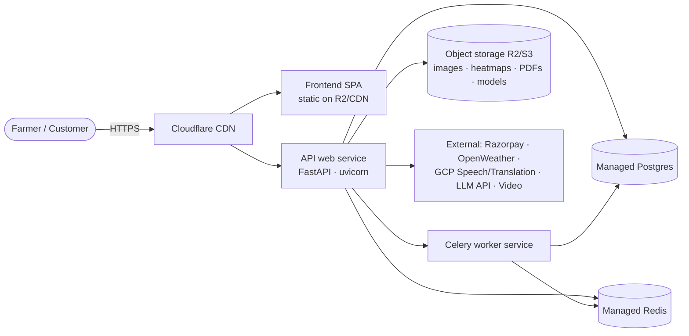
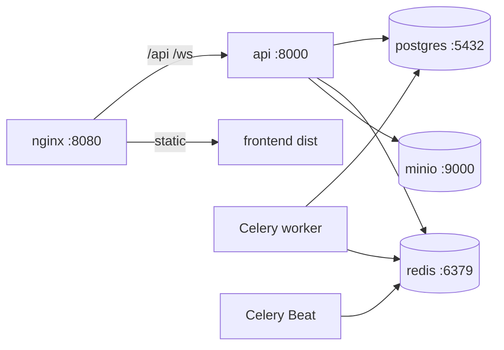

# Deployment — NeuroPlant AI

Two supported paths: the **containerized stack** (Docker Compose — local
replication of production) and the **PaaS deployment** (Railway / Render).

## 1. Target topology (PaaS — Railway / Render)



- **Web service** (`api`): stateless FastAPI; horizontally scalable; runs
  migrations as a release step before the web/worker services are updated.
- **Worker service** (`worker`): Celery, same image, different command.
- **Managed services**: Postgres + Redis provisioned by the platform.
- **Planned object storage**: Cloudflare R2 (S3-compatible, zero egress fees).
- **Frontend**: built to `dist/` and served via CDN + API reverse proxy.
- **Scheduler**: run exactly one Celery Beat service for reminder dispatch and
  calendar/treatment reminder generation. Multiple Beat instances can enqueue
  duplicate scheduled ticks.

### Env matrix (see `docker/.env.example`)

| Env | URL | Notes |
|---|---|---|
| `DATABASE_URL` | `postgresql+asyncpg://…` | managed Postgres |
| `REDIS_URL` / Celery broker+backend | `redis://…` | managed Redis |
| `CELERY_TASK_ALWAYS_EAGER` | `false` | broker-driven |
| `STORAGE_PROVIDER` | `s3` | R2 endpoint |
| `S3_ENDPOINT_URL/BUCKET/KEYS` | R2 | object storage |
| `JWT_*` secrets | 64-byte random | required in prod |
| `RATE_LIMIT_ENABLED` | `true` | currently process-local; use a shared limiter before horizontal scaling |
| `ALLOWED_ORIGINS` | explicit HTTPS origins | localhost origins are rejected in prod |
| Provider keys | `RAZORPAY_*`, `OPENWEATHER_API_KEY`, `GOOGLE_*`, `LLM_API_KEY` | optional, graceful degrade |

Production settings fail startup when the database is not PostgreSQL, debug or
Celery eager mode is enabled, rate limiting is disabled, object storage is not
S3-compatible, CORS still includes localhost, or JWT secrets are missing,
defaulted, too short, or equal.

**Deployment limitation:** the S3/R2 storage adapter is not implemented yet.
The current storage service raises `NotImplementedError` when configured with
`STORAGE_PROVIDER=s3`, so scan/media upload and retrieval are not production
ready. The Compose MinIO service supplies infrastructure only; it does not
provide an application adapter.

## 2. Local containerized stack



```bash
cd docker
cp .env.example .env
docker compose up --build
# Compose runs the one-shot `migrate` service before starting the API/worker/Beat.
# web → http://localhost:8080 · api docs → http://localhost:8000/docs
# minio console → http://localhost:9001 (neuroplant / neuroplant-minio)
```

## 3. Native dev (no Docker)

Backend: SQLite (`DATABASE_URL=sqlite+aiosqlite:///./neuroplant.db`) + Celery
eager (`CELERY_TASK_ALWAYS_EAGER=true`) → `uvicorn app.main:app --reload`.
Frontend: `npm run dev` (proxies `/api` → `localhost:8000`).

For periodic notifications, native development must also have Redis available;
set `CELERY_TASK_ALWAYS_EAGER=false` and run one worker plus one Beat process
using the commands in `backend/README.md`. Eager mode alone does not run Beat.

## 4. CI/CD (GitHub Actions)

```
push/PR → ci.yml (ruff · mypy · pytest · typecheck · build)
main green → deploy.yml (M11): build images → migrate → deploy web+worker → smoke
ai push (dataset approved) → retrain.yml (M4): train → eval gate → register model
```

For PaaS, configure the release command as `alembic upgrade head` using the
same image and production `DATABASE_URL`, then deploy API and worker services.
The image includes `alembic.ini` and the migration scripts. Do not run
migrations independently from every API replica.

## 5. Probes & health

- `GET /health` — liveness (process up).
- `GET /ready` — readiness (DB reachable) → `503` when not.
Platform healthchecks wired to `/ready`.

## 6. Release checklist (go-live, M11)

- [ ] Secrets rotated; `.env` not in git
- [ ] `RATE_LIMIT_ENABLED=true`, CORS allow-list correct, HTTPS enforced
- [ ] Migrations run as release step; down-migrations tested
- [ ] Canary smoke: register → scan → order → payout
- [ ] Sentry + uptime monitoring configured; alerts for `/ready` 503s
- [ ] Backups (managed Postgres snapshots) verified restore
