# AI Pipeline — NeuroPlant AI

Training → versioning → serving → feedback loop. Two model families ship in v1
(**disease classification**, **yield regression**); the pipeline and registry
are model-agnostic (pest / deficiency / livestock later).

## 1. Pipeline overview

```mermaid
flowchart LR
    SRC[Public datasets<br/>PlantVillage · PlantDoc · curated] --> ING[Ingest + validate<br/>label map, checksums]
    ING --> DS[(Dataset vN<br/>versioned)]
    DS --> AUG[Preprocess + augmentation<br/>OpenCV]
    AUG --> TR[Train<br/>Keras transfer learning<br/>EfficientNet / MobileNetV3]
    TR --> EV[Eval gate<br/>accuracy · ECE · per-class]
    EV -- pass --> REG[(model_versions<br/>status=staging)]
    EV -- fail --> TR
    REG --> PROMO[Promote → production<br/>registry-only change]
    PROMO --> SVC[Serving<br/>LocalTensorFlowClassifier]
    SVC --> FALLBACK{confidence < 0.6?}
    FALLBACK -- yes --> CLOUD[CloudClassifier<br/>Vertex AI / Gemini vision]
    FALLBACK -- no --> OUT
    CLOUD --> OUT[Result + ai_provider + model_version]

    FARM[Farmer scan] --> UNK{unknown disease?}
    UNK -- yes --> UP[unknown_disease_samples<br/>status=pending]
    UP --> EXPERT[Expert review + label]
    EXPERT -- approve --> ING
    EXPERT -- reject --> DROP[Discard with reason]

    CROP[Drone/satellite/IoT images<br/>future] --> ING
```

## 2. Disease classification (M2)

- **Backbone**: EfficientNetB0 / MobileNetV3-Large transfer-learned on ImageNet,
  fine-tuned head; input 224×224×3; output = softmax over label map.
- **Preprocessing** (OpenCV): resize/center-crop, normalization, optional
  CLAHE for low-light field images; EXIF-strip enforced at upload.
- **Part awareness**: `part_type` (leaf/fruit/stem/plant) is a model input or
  per-part fine-tuned head — decided at training-time, driven by the label map.
- **Serving**:
  - Primary: `LocalTensorFlowClassifier` (SavedModel/Keras in image).
  - Fallback: `CloudClassifier` (Vertex AI endpoint / Gemini vision) when
    top-1 confidence < **0.6**.
  - Result records `ai_provider` + `model_version` + `dataset_version`.
- **Severity / stage / symptoms**: rule heuristics over symptom coverage +
  confidence, calibrated per disease (stored in the `diseases` catalog).

## 3. Explainability — Grad-CAM (M2)

- During inference, gradients of the top class wrt the last conv layer →
  class-activation map → OpenCV `JET` colormap → blended overlay → uploaded to
  object storage (`heatmap_url`).
- Plain-language explanation: top contributing region (position label) +
  matched symptoms → template sentences localized by language.

## 4. On-device (offline) model (M2)

- Quantized **MobileNet** exported to **TF.js** (`tflite` → `tensorflowjs`
  converter), reduced common-class subset (~top 20 diseases by usage).
- Browser runs inference offline; result is marked **offline estimate** and
  re-scored server-side on sync.

## 5. Crop Doctor scoring (M3)

Per scan: health features (disease, confidence, severity, stage, symptom
count). Score `0–100` per entry; **trend** = slope across series; **treatment
effectiveness** = Δscore since prior scan; **recovery probability + expected
date** = regression over score curve (logistic fit); **critical alert** when
score < threshold or worsening 2 scans consecutively. Weekly PDF via ReportLab
in Celery.

## 6. Yield prediction (M5)

- Features: crop, soil (NPK/pH/OC), weather history, area, treatments, stage.
- Regression (gradient-boosting baseline → neural) with confidence; harvest
  date from crop growth-days + accumulated temperature (GDD).
- Rule-baseline floor until historical data accumulates; versioned like disease.

## 7. Soil deficiency (M3)

- Rule engine over soil_record ranges (pH/NPK/OC) → status + recommended
  fertilizer; optional classifier when labeled data exists.

## 8. Model & dataset registry

| Table | Purpose |
|---|---|
| `datasets` | version, source, num_classes, num_images, checksum |
| `model_versions` | name (`disease|yield|soil`), artifact_url, dataset_version, metrics, status |

Promotion is **registry-only** — inference reads the production version; rollback
= repoint registry. Scans/yield records store the version for auditability.

## 9. Feedback loop (dataset platform, M4)

Unknown → expert label → approve → new `dataset_version` → Celery retrain →
eval gate → staging → promote. Guarded by eval threshold; human review before
promotion. All inferred-only samples are never auto-labeled into the dataset.
