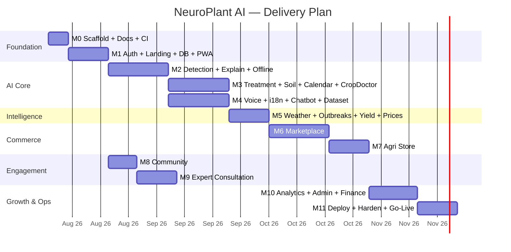

# Milestone Timeline — NeuroPlant AI

Each milestone **ships working, tested, documented increments** and **stops for
explicit approval** before the next begins. Estimates assume **1 full-time
engineer**; parallelizable work (docs, seeders, tests) can compress the tail.

## Phases & scope

| M | Milestone | Scope (highlights) | Est. | Depends on |
|---|---|---|---|---|
| **M0** | Scaffold + Docs + CI | monorepo, compose, Dockerfiles, CI, **12-doc pack** | 1 wk | — |
| **M1** | Auth + Landing + DB + PWA | roles, OTP/password, JWT rotation, MFA, devices, login history, RBAC, Alembic, seeders, app shell, PWA+IndexedDB, landing | 2 wk | M0 |
| **M2** | AI Detection + Explain + Offline | training pipeline, model, cloud fallback, Grad-CAM, `/scans`, history, upload+camera, offline queue/sync | 3 wk | M1 |
| **M3** | Treatment + Soil + Calendar + Crop Doctor | treatment catalog, soil, calendar, Crop Doctor (multi-plant, recovery, PDF), assistant profile | 3 wk | M2 |
| **M4** | Voice + 12 langs + Chatbot + Dataset | i18n 12, hybrid STT/TTS, voice everywhere, RAG chat, dataset platform (label→retrain→promote) | 3 wk | M2 |
| **M5** | Weather + Outbreaks + Yield + Prices + Maps | weather/risk, outbreak heatmaps+verify+notify, yield prediction, price dashboard, maps, notifications | 2 wk | M2/M3 |
| **M6** | Marketplace | listings, orders, Razorpay + payouts, tracking, ratings, chat, negotiation, AI price rec, nearby buyers, delivery adapter, finance log | 3 wk | M1/M5 |
| **M7** | Agri Store | verified sellers, products, search/compare/reviews, AI disease recs, warranty/expiry | 2 wk | M6 |
| **M8** | Community | posts, images, comments, likes, shares, expert replies | 1.5 wk | M1 |
| **M9** | Expert Consultation | slots, appointments, video/voice/chat calls | 2 wk | M1/M8 |
| **M10** | Analytics + Admin + Smart Farm + Finance | farmer/admin analytics, smart-farm dashboard, financial dashboard + exports, schemes, audit log | 2.5 wk | M6/M7 |
| **M11** | Deploy + Harden + Go-Live | Railway/Render, CI/CD, hardening, monitoring, extensibility-seams verification, release | 2 wk | M10 |

**Total ≈ 27–29 weeks.**

## Gantt

## Delivery cadence & gates

- **Definition of done per milestone**: code merged on `main`, backend `pytest`
  green, frontend typecheck+build green, CI green, milestone feature flows smoke
  tested end-to-end, docs updated.
- **Approval gate**: milestone presented with demo + test evidence → user
  approves → next milestone begins. Scope creep is queued to a later milestone.

## Team & parallelization notes

- Docs, seeders, and e2e test scaffolding are parallelizable with feature work.
- AI dataset curation (M2/M4) can proceed in parallel on Colab/GPU.
- Risk of timeline slip: dataset/model accuracy (M2), payment flow verification
  (M6), voice-language fidelity (M4). Mitigations in `docs/10-risk-analysis.md`.
